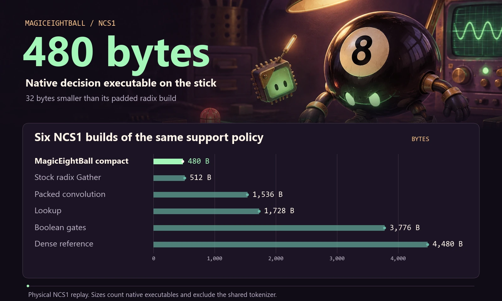
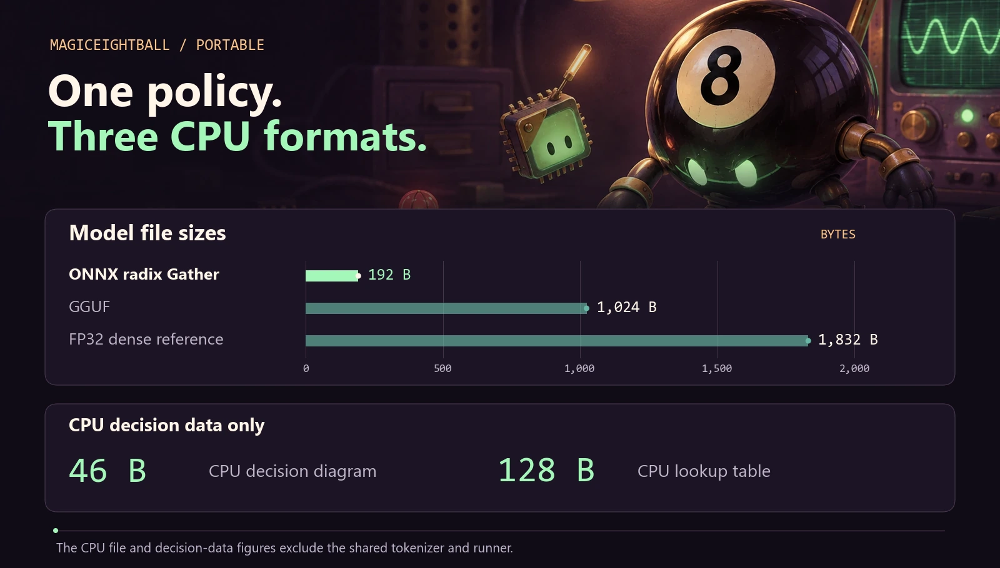
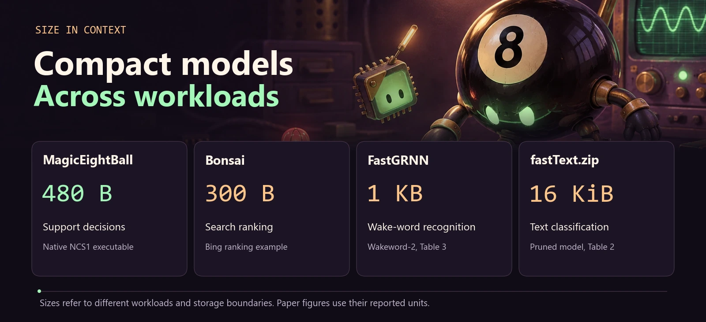
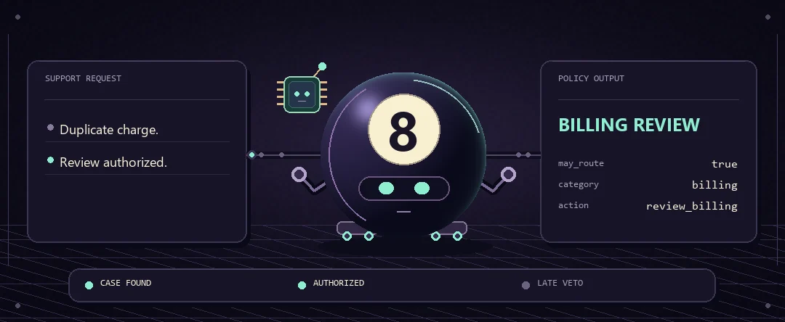

---
language:
  - en
license: other
license_name: mit-and-apache-2.0
license_link: LICENSE
tags:
  - intel-ncs1
  - myriad-2
  - openvino
  - fp16
  - decision-model
  - rule-engine
---

# MagicEightBall for Intel NCS1


[GIF version](./assets/workbench-motion.gif) · [Still banner](./assets/workbench.webp) · [Motion inspiration](https://huggingface.co/spaces/huggingface/moe-blogpost)

MagicEightBall reads up to **131,072 Needle 3 tokens** and returns a Boolean answer, a category, and a proposed action. The host counts tokens and extracts evidence. The **480-byte** native build runs the decision head on the original Intel Neural Compute Stick. This release also includes the **512-byte** stock build.

## Choose a format

| Card | Runtime |
|---|---|
| Native NCS1 | The archives on this page use OpenVINO 2020.3.2 and the physical stick. |
| [ONNX](https://huggingface.co/chadstthomas/MagicEightBall-ONNX) | The 192-byte radix Gather runs under ONNX Runtime on CPU. |
| [FP32 Base](https://huggingface.co/chadstthomas/MagicEightBall-FP32) | The 1,832-byte dense reference uses FP32 weights and direct Boolean outputs. |
| [GGUF](https://huggingface.co/chadstthomas/MagicEightBall-GGUF) | The 1,024-byte container runs with the included MagicEightBall CPU reader. |

## Size comparisons



The compact native executable is 32 bytes smaller than its padded radix build. The compact release and shared tokenizer together use **24,111 bytes**. Python, OpenVINO, firmware, and host code have separate sizes. [Full-size chart](./assets/size-native-ncs1.webp) · [Exact chart data](./size-chart-data.json) · [Physical size comparison](./measurements/compact-gather-physical-ncs1.json)





The published examples have different workloads and storage boundaries. The six-build native chart compares the same policy on the same hardware. [Bonsai](https://proceedings.mlr.press/v70/kumar17a/kumar17a.pdf) · [FastGRNN](https://proceedings.neurips.cc/paper_files/paper/2018/file/ab013ca67cf2d50796b0c11d1b8bc95d-Paper.pdf) · [fastText.zip](https://arxiv.org/pdf/1612.03651#page=7)

## Three decisions at the workbench



- **Approve a billing review.** `Duplicate charge. Review authorized.` returns `true`, `billing`, and `review_billing`.
- **Clear a proposed action.** `Duplicate charge. Review authorized. Do not route.` returns `false`, `billing`, and `null`.
- **Abstain when evidence is absent.** `General help requested.` returns `false`, `null`, and `null`.

The three fields are `may_route`, `category`, and `action`. The caller receives the proposal as data. [Support policy](./support.json) · [Still image](./assets/relay-decisions-still.webp)

## Run on the original stick

Use a Windows NCS1 toolchain with OpenVINO 2020.3.2, Python 3.7, NumPy, and SentencePiece 0.1.99. Download or clone these files together and keep the tokenizer beside `runtime.py`. Replace the toolchain path with your installation. [MyriadForge setup guide](https://github.com/chadstthomas-svg/myriadforge/blob/main/docs/NCS1_ROADMAP.md)

```powershell
$toolchain = 'D:/NTVStudy/tools/ncs1'
$python = Join-Path $toolchain '.venv/Scripts/python.exe'
& $python runtime.py bundles/magiceightball-ncs1-compact.m8b --toolchain $toolchain --release-stick ncs1 --text 'duplicate charge. review authorized.'
```

For a batch, use `--serve` and send one JSON line containing a `documents` array. For updates to an existing document, use `--stream` and send `{"append":"next fragment"}` per line. The final accepted document may contain exactly 131,072 tokens. An append that would exceed the limit is rejected and preserves the prior document state. [Runtime source](./runtime.py) · [Physical stream replay](./measurements/release-stream-ncs1.json)

## Measurements

The release passed all 128 support-policy assignments on a physical NCS1, including full-context fixtures, a late veto, and rejection at 131,073 tokens. The matched comparison used 31 warmed repeats per workload on the same Intel Core i7-12650H Windows host. All rows below use the same tokenizer and evidence extraction. [Physical release replay](./measurements/release-vector-ncs1.json) · [Complete comparison report](./measurements/ncs1-cpu-comparison.json)

| Backend | Decision artifact | 128 short decisions, p50 / p95 | Fresh 131,072-token authorization, p50 / p95 |
|---|---:|---:|---:|
| Physical NCS1, one request | 512-byte native executable | 6.43 / 10.73 ms | 44.24 / 55.55 ms |
| OpenVINO CPU, matched Gather | 258-byte source ONNX | 3.91 / 5.99 ms | 44.25 / 55.24 ms |
| CPU Boolean interpreter | 714-byte source policy | 4.57 / 8.26 ms | 39.26 / 49.48 ms |
| CPU lookup | 128-byte generated table | 3.82 / 6.95 ms | 37.63 / 50.03 ms |
| CPU decision diagram | 46-byte generated diagram | 4.03 / 7.37 ms | 37.92 / 52.50 ms |
| Compiled CPU lookup | 128-byte table and 2,560-byte native library | 3.29 / 4.02 ms | 33.58 / 38.09 ms |
| OpenVINO 2020.3.2 CPU Gather | Same 258-byte source ONNX | 4.04 / 4.80 ms | 33.53 / 41.25 ms |

The CPU table and diagram figures cover decision data. Their runners also use the policy, tokenizer, and output mapping. The NCS1 took 223.70 ms median for the same 128 decisions issued one by one, about 35 times as long as the batch. In the streaming replay, short appends near the context limit took **1.90 ms median** after ingesting the initial prefix. Fresh full-context requests spend most of their time in host preparation. [Complete comparison report](./measurements/ncs1-cpu-comparison.json) · [Physical stream replay](./measurements/release-stream-ncs1.json)

The **480-byte radix Gather** is the smallest native artifact verified in this comparison. It passed all 128 assignments, two exact-limit documents and overflow rejection on NCS1. It took 5.31 ms median for one batch of 128 short decisions, compared with 5.37 ms for its 512-byte padded control. The compact archive also passed the vector and mixed-context replay. [Physical compact comparison](./measurements/compact-gather-physical-ncs1.json) · [Compact archive replay](./measurements/compact-release-vector-ncs1.json) · [Size and competitor comparison](./COMPETITORS.md)

The stock build's **30-minute** mixed workload on the physical NCS1 completed **107,104 native requests** and **3,507,656 checked decisions**, with **26,776 overflows rejected**. The run exercised full documents, incremental vetoes and 128-decision batches on the resident release. [Physical soak report](./measurements/soak-release-30m-ncs1.json)

The compact archive also passed a **30-minute** physical NCS1 run with **98,484 native requests**, **3,225,351 checked decisions**, and **24,621 overflows rejected**. Incremental veto appends after the initial prefix took **1.78 ms median** and **2.33 ms p95** during that run. [Compact soak report](./measurements/soak-compact-30m-ncs1.json)

## Runtime comparison


| Runtime | Model file | Calls for 128 short decisions | 128 short decisions, p50 / p95 | Fresh 131,072-token late veto, p50 / p95 |
|---|---:|---:|---:|---:|
| OpenVINO MYRIAD, compact NCS1 | 480 B | 1 | 5.31 / 5.87 ms | 33.68 / 39.24 ms |
| ONNX Runtime CPU, radix Gather | 192 B | 1 | 2.55 / 3.01 ms | 23.31 / 25.20 ms |
| ONNX Runtime CPU, FP32 dense | 1,832 B | 128 | 4.80 / 5.25 ms | 22.54 / 25.04 ms |
| MagicEightBall CPU reader, GGUF I8 | 1,024 B | 128 | 2.90 / 3.61 ms | 22.39 / 25.70 ms |

All four matched the same 128 Boolean assignments and the two exact-limit fixtures, and rejected 131,073 tokens. Timings include host tokenization, evidence extraction, head execution and decoding. Runs used the same Intel Core i7-12650H host and fixtures in separate sessions with different software versions. ONNX radix had the lowest median for the 128 short decisions. NCS1 provides a physical decision-head offload in one USB request for up to 128 decisions. Fresh long documents are dominated by host-side text preparation. [Native samples](./measurements/compact-gather-physical-ncs1.json) · [Portable samples and software versions](./measurements/portable-cpu-comparison.json) · [Run all three CPU examples](https://github.com/chadstthomas-svg/myriadforge/tree/main/labs/shave_models/boolean/portable_comparison)

## Industry use cases

| Starter pack | Example result after evidence and approval |
|---|---|
| Dealership service intake | Propose service or inspection review. A customer decline clears the proposal. |
| Manufacturing maintenance | Propose review of vibration or lubrication evidence. A maintenance hold clears the proposal. |
| Store security | Route a door or camera equipment event for staff review. An active drill or a cleared alert clears the proposal. |

The [three frontline packs](./industries/frontline/README.md) share one resident graph. On CPU and physical NCS1, they matched **27 of 27** hand-authored cases and **384 of 384** Boolean assignments. Each pack passed a late veto at exactly 131,072 tokens. The policies made zero proposals in the 15 expected no-action cases. The same classifier with approval and veto checks removed made 12. [CPU simulation](./measurements/industry-simulation-frontline-cpu.json) · [Physical NCS1 simulation](./measurements/industry-simulation-frontline-ncs1.json)

Two related packs cover shipment and address exceptions in **logistics and fulfillment** and network and capacity incidents in **software on-call**. The record-mode examples take evidence from a declared field, so an archived approval or hold stays outside the decision. [Run the starter packs](./industries/README.md) · [Labeled cases](./industries/scenarios.json)

Both CPU and physical NCS1 agreed with all **18 of 18** simulated outcomes, including two 131,072-token cases with late vetoes. MagicEightBall issued zero proposals on the ten expected no-action cases. A baseline using the same rules without approval or veto checks issued seven. These results are from hand-authored simulations. [CPU simulation](./measurements/industry-simulation-cpu.json) · [Physical NCS1 simulation](./measurements/industry-simulation-ncs1.json)

## Scope and downloads

The shipped English support policy recognizes specific phrases and evaluates authored Boolean rules. Use it for deterministic routing and action proposals within that policy. General support chat, interpretation of new intents, and execution of actions belong in the surrounding application. The native NCS1 evidence applies to the original stick and the pinned runtime. The archive carries a separately compiled legacy NCS2 image.

| Artifact | Bytes |
|---|---:|
| [Stock native archive](./bundles/magiceightball.m8b), including both targets | 735 |
| [Compact native archive](./bundles/magiceightball-ncs1-compact.m8b), with the 480-byte NCS1 image | 699 |
| [Shared tokenizer](./needle3-tokenizer.m8t.xz) | 23,412 |
| Stock archive plus tokenizer | **24,147** |
| Compact archive plus tokenizer | **24,111** |

Each total covers one archive and the shared tokenizer. Python, OpenVINO, firmware, runner source and the artwork have separate sizes. [Checksums](./SHA256SUMS.txt) · [GitHub release and ZIP](https://github.com/chadstthomas-svg/myriadforge/releases/tag/magiceightball-ncs1-v0.1.0)

MyriadForge source and policy use the MIT license. The shared tokenizer restores the original Apache-2.0 Needle 3 tokenizer bytes and verifies the pinned SHA-256. [License](./LICENSE) · [Tokenizer provenance](./NOTICE.txt)
